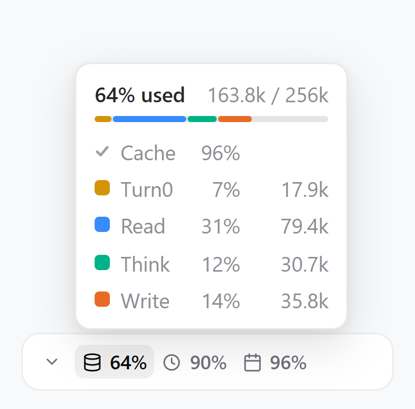
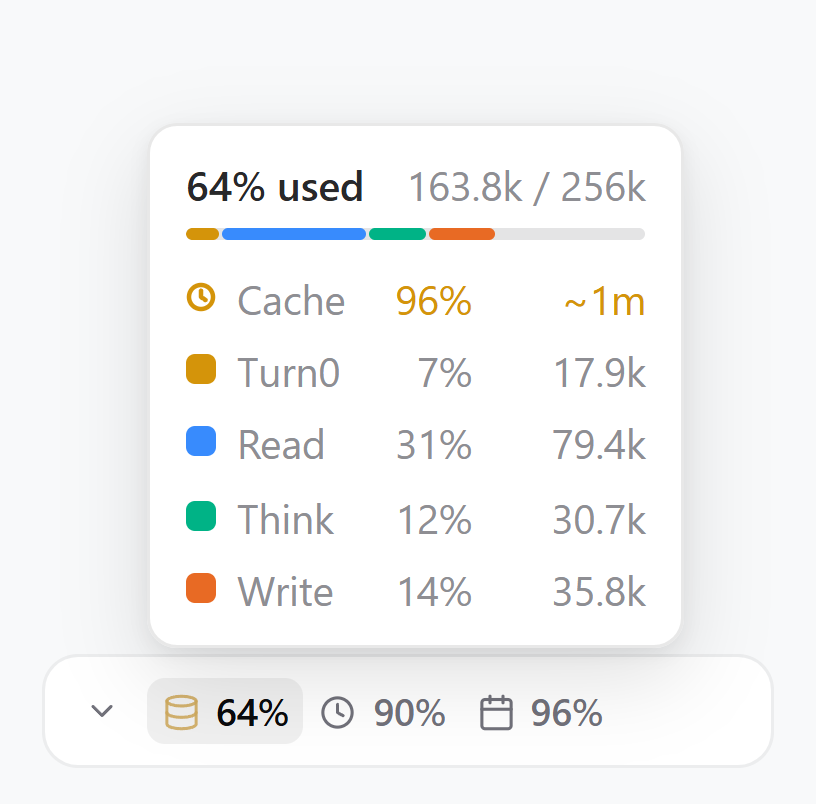
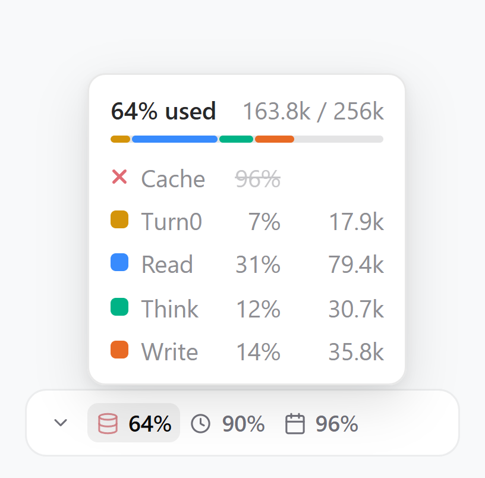
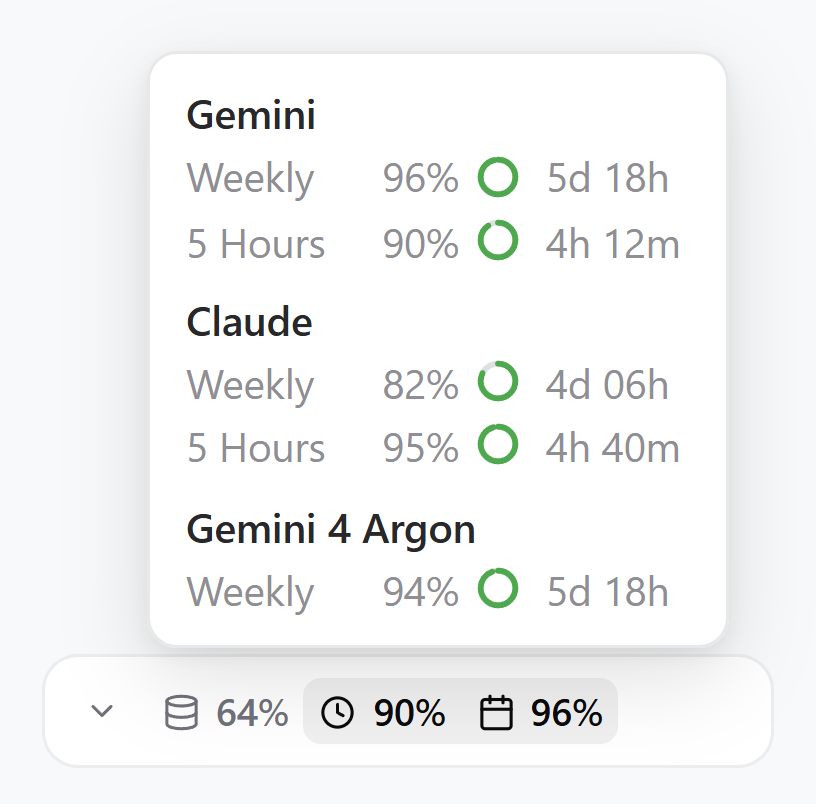

# agy-capsule

[中文](./README.md) | **English**

Context and quota capsules in the Antigravity composer footer.

  
  
  
  

## Features

- **Inline dual capsules**: Show the current conversation's context usage and remaining 5h / Weekly quotas in the composer footer, updated in real time.
- **Token breakdown**: Hover to see the proportions and token counts for `Turn0`, `Read`, `Think`, and `Write`.
- **Cache expiry alerts**: Turn yellow 3 minutes after the last turn, with a countdown (`~1m`), then show a red indicator when the cache expires at 4 minutes.
- **Multi-model quota panel**: Automatically match the model selected in the footer (such as `Gemini`, `Claude`, `Argon`, or `Carbon`). Hover to see each group's remaining 5h and weekly quotas, plus reset countdowns.
- **Light / dark adaptation & cross-version compatibility**: Reuse the host's CSS variables. Mount through a native Sidecar and CDP without modifying client source code, so the plugin can be used after client updates.

## Installation

1. Copy the [`agy-capsule`](./agy-capsule) folder into the Antigravity plugins directory:
   - **Windows**: `%USERPROFILE%\.gemini\config\plugins\agy-capsule`
   - **macOS / Linux**: `~/.gemini/config/plugins/agy-capsule`
2. Enable **agy-capsule** in Antigravity's **Plugins** panel (includes the `/ctx` command).

## Disclaimer & Testing Status

- **Cache expiry is an estimate**: The cache status indicator (yellow warning at 3 minutes / red expired at 4 minutes) is estimated locally based on elapsed time since the last turn and is for reference only; actual cache hits depend on the server.
- **Tested environments**: Currently tested only on **Windows + Pro plan**. Testing, feedback, and PRs on **macOS** and **Ultra plan** environments are very welcome!

## License

[MIT](./LICENSE)
