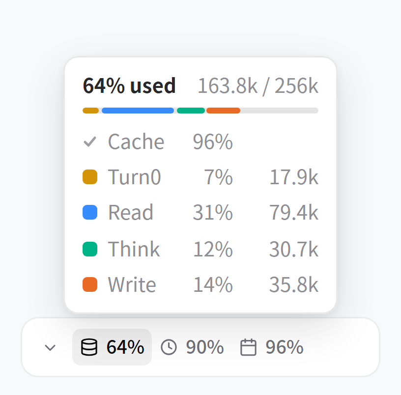
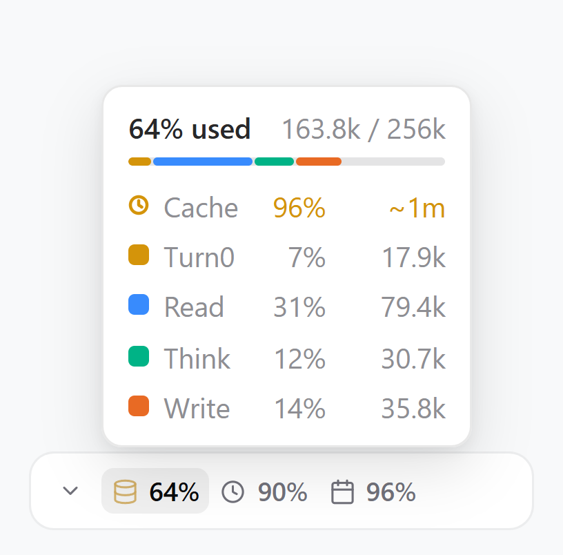
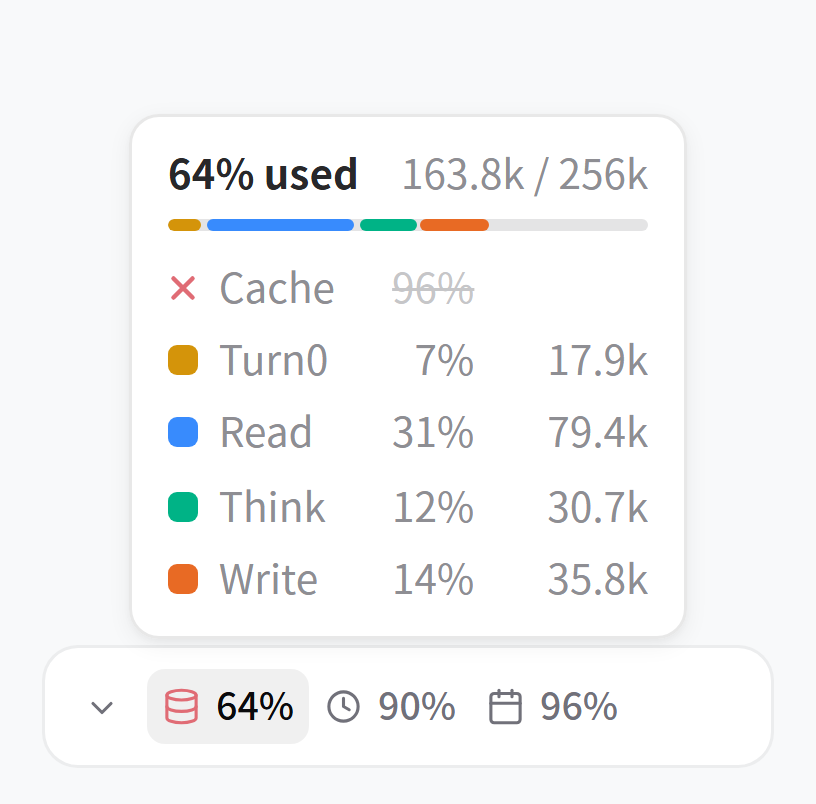

# agy-capsule

**中文** | [English](./README.en.md)

Antigravity 输入框底栏的上下文与配额胶囊。

  
  
  
  

## 功能

- **内联双胶囊**：嵌入输入框底栏，实时显示当前会话 Context 占比与 5h / Weekly 剩余配额。
- **Token 构成明细**：悬停查看 `Turn0`、`Read`、`Think`、`Write` 分段占比与 Token 用量。
- **缓存过期提醒**：距上一轮满 3 分钟变黄倒计时（`~1m`），满 4 分钟变红标记 `Cache` 过期。
- **多模型配额面板**：自动匹配底栏当前模型（如 `Gemini`、`Claude`、`Argon`、`Carbon`），悬停查看各分组 5h 与周配额剩余比例及重置倒计时。
- **昼夜自适应 & 跨版本兼容**：直接复用宿主 CSS 变量；通过原生 Sidecar 与 CDP 挂载，不改客户端源码，客户端升级后直接使用。

## 安装

1. 将 [`agy-capsule`](./agy-capsule) 文件夹复制到 Antigravity 插件目录：
   - **Windows**: `%USERPROFILE%\.gemini\config\plugins\agy-capsule`
   - **macOS / Linux**: `~/.gemini/config/plugins/agy-capsule`
2. 在 Antigravity 的 **Plugins** 面板启用 **agy-capsule**。

## 声明

- **缓存过期提示仅供参考**：缓存状态（3 分钟预警 / 4 分钟过期）系根据距上一轮对话的时间间隔本地估算，实际命中情况以服务端为准。
- **测试环境与反馈**：目前仅在 **Windows + Pro订阅**环境下完成测试，欢迎在 **macOS** 以及 **Ultra 订阅**环境下测试并反馈问题或提交 PR。

## License

[MIT](./LICENSE)
