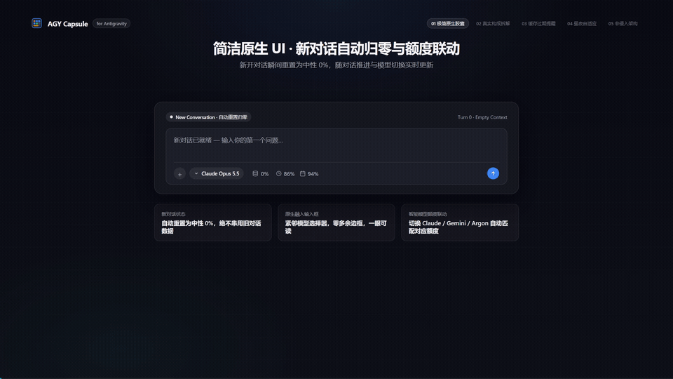
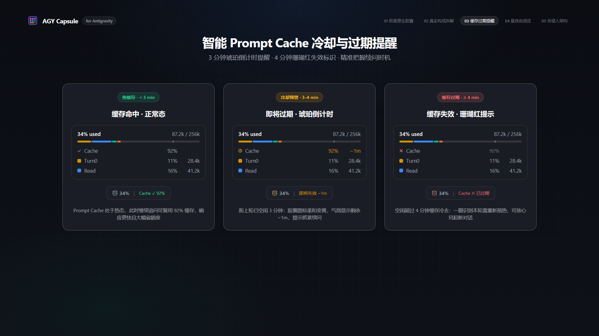

<div align="center">


# AGY Capsule (`agy-capsule`)

**极简、原生、免改包的 Antigravity 上下文与额度监控胶囊（Context + Usage Capsule）**

Minimalist real-time context window, prompt-cache TTL & model quota capsule for **Antigravity Desktop & IDE** — zero app patching, auto dark/light theme, and ground-truth SQLite telemetry.



</div>

---

## 核心特性 Highlights

### 1. 简洁高效的原生 UI 设计
- **底部输入框胶囊（Deck Metrics Strip）**：无感融入聊天输入框左下角（模型选择器旁），实时展示当前上下文占用百分比，以及当前所选模型（Gemini / Claude / Argon）对应的 **5 小时额度** 与 **周额度**。
- **悬停详情气泡**：鼠标悬停即可展开真实 API 账单级构成拆解：
  - 分段进度条：`Turn0`（初始系统提示）/ `Read`（读入上下文）/ `Think`（推理过程）/ `Write`（模型输出）
  - **200k 自动压缩阈值刻度线**（直观预警触发 `/compact` 的临界点）
  - **全模型额度环形看板**：一次性查看 Gemini、Claude、Argon 的 5 小时与周额度及重置倒计时。
- **新对话自动归零**：新建对话或尚未产生首个回合数据时，自动显示干净的中性 `0%`，绝不串用上一个对话的历史百分比或缓存警告状态。

<div align="center">
  
  
</div>

### 2. 智能 Prompt Cache 冷却与过期提醒
Prompt Cache 过期后继续对话会重新产生大量非缓存输入计费。插件自动追踪距上一轮对话的空闲时长：
- **热缓存（`< 3 分钟`）**：正常中性图标 + `Cache ✓ 92%`，代表继续追问可高效命中缓存。
- **冷却预警（`3–4 分钟`）**：底部胶囊图标柔和变为**琥珀色**，气泡内显示时钟图标与 `~1m` 倒计时，提醒你抓紧追问以续期缓存。
- **缓存已过期（`≥ 4 分钟`）**：底部胶囊图标变为**珊瑚红**，气泡内缓存命中率显示删除线，提示你缓存已失效，若无需延续当前上下文可放心开新对话。

<div align="center">
  
</div>

### 3. 昼夜模式自适应（Dark / Light Mode）
胶囊条、悬停气泡及右侧边栏面板全部优先使用宿主页面的标准 CSS 主题变量（`--foreground`、`--muted-foreground`、`--card`、`--border`、`--background`），无论你在 Antigravity 中使用深色还是浅色主题，都会自动无缝融合。

### 4. 非侵入式免改包架构 & 版本更新高韧性
> 什么是“非注入 / 免改包”？

与需要解包修改客户端 `app.asar`、注入第三方脚本或替换核心文件的传统魔改不同，**AGY Capsule 完全不修改 Antigravity 客户端安装目录下的任何文件**：
- **官方 Sidecar + 轻量挂载**：插件按照 Antigravity 原生插件规范运行在 `~/.gemini/config/plugins/context-monitor`，通过本地只读读取 `~/.gemini/antigravity/conversations/<id>.db`（`gen_metadata` 表）和官方 Language Server 接口获取真实数据，**零 Token 消耗、零网络抓包**。
- **客户端更新后依然可用**：仅挂载于稳定的 `.agy-composer-footer` 锚点，无需在客户端更新后重新打补丁，。
- **一键还原**：在 Antigravity 插件管理中关闭或删除该文件夹即可彻底卸载，不留任何系统残留。

### 5. 附带右侧边栏面板 & `/ctx` 快捷指令
- **右侧边栏实时面板**：在右侧 Auxiliary Pane 提供常驻实时视图（`sidecar://context-monitor/context_monitor/`）。
- **`/ctx` 命令技能**：在任意对话中输入 `/ctx` 即可调用内置 Python 脚本输出精确的 JSON 上下文统计报告。

---

## 快速安装 Installation

> **无需额外安装 Node.js！** 插件后台服务与挂载脚本直接复用 Antigravity 内置运行时。

### 方式一：一键脚本安装（推荐）

1. 克隆或下载本仓库压缩包并解压：
   ```bash
   git clone https://github.com/Lumidarin/agy-capsule.git
   cd agy-capsule
   ```
2. 运行对应平台的安装脚本：
   - **Windows**：双击运行根目录下的 **`一键安装.bat`**
   - **macOS / Linux**：
     ```bash
     chmod +x install.sh && ./install.sh
     ```
3. **完全退出并重新打开 Antigravity**（首次安装需要重启以拉起 Sidecar 服务）。

### 方式二：手动复制安装

将仓库中的 `context-monitor` 文件夹完整复制到对应系统的插件目录：
- **Windows**：`%USERPROFILE%\.gemini\config\plugins\context-monitor`
- **macOS / Linux**：`~/.gemini/config/plugins/context-monitor`

放好后重启 Antigravity 即可；打开任意对话，输入框左下角模型选择器右侧便会出现实时胶囊。

---

## 目录结构 Structure

```text
agy-capsule/
├── README.md
├── LICENSE
├── 一键安装.bat                # Windows 一键安装脚本
├── install.sh                 # macOS / Linux 一键安装脚本
├── assets/                    # 宣传视频与预览图
│   ├── promo.mp4
│   ├── demo.gif
│   ├── preview-dark.png
│   ├── preview-light.png
│   └── preview-cache.png
└── context-monitor/           # 插件本体（复制到 ~/.gemini/config/plugins/）
    ├── plugin.json
    ├── README.md
    ├── assets/logo.svg
    ├── sidecars/context_monitor/
    │   ├── sidecar.json
    │   ├── server.mjs         # 只读 SQLite 遥测 + 额度查询 + 侧边栏 UI
    │   └── deck_injector.mjs  # 底部输入框胶囊动态挂载器
    └── skills/ctx/
        ├── SKILL.md           # /ctx 指令说明
        └── scripts/ctx_report.py
```

## 开源协议 License

[MIT License](LICENSE)
