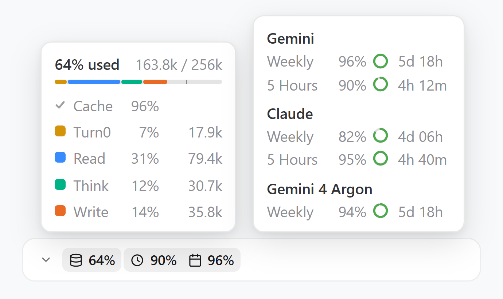

# AGY Capsule

Antigravity 输入框底栏的上下文与配额胶囊。

  
  

## 功能

- **内联双胶囊**：嵌入输入框底栏，实时显示当前会话 Context 占比与 5h / Weekly 剩余配额。
- **Token 构成明细**：悬停查看 `Turn0`、`Read`、`Think`、`Write` 分段占比与自动压缩（Compaction）阈值线。
- **缓存过期提醒**：距上一轮满 4 分钟变黄倒计时（`~1m`），满 5 分钟变红标记 `Cache` 过期。
- **多模型配额面板**：汇总 `Gemini`、`Claude`、`Gemini 4 Argon` 的 5h 与周配额剩余比例及重置倒计时。
- **昼夜自适应 & 跨版本兼容**：直接复用宿主 CSS 变量；通过原生 Sidecar 与 CDP 挂载，不改客户端源码，客户端升级后直接使用。

## 安装

1. 将 [`context-monitor`](./context-monitor) 文件夹复制到 Antigravity 插件目录：
   - **Windows**: `%USERPROFILE%\.gemini\config\plugins\context-monitor`
   - **macOS / Linux**: `~/.gemini/config/plugins/context-monitor`
2. 在 Antigravity 的 **Plugins** 面板启用 **AGY Capsule**（支持 `/ctx` 命令）。

## License

[MIT](./LICENSE)
